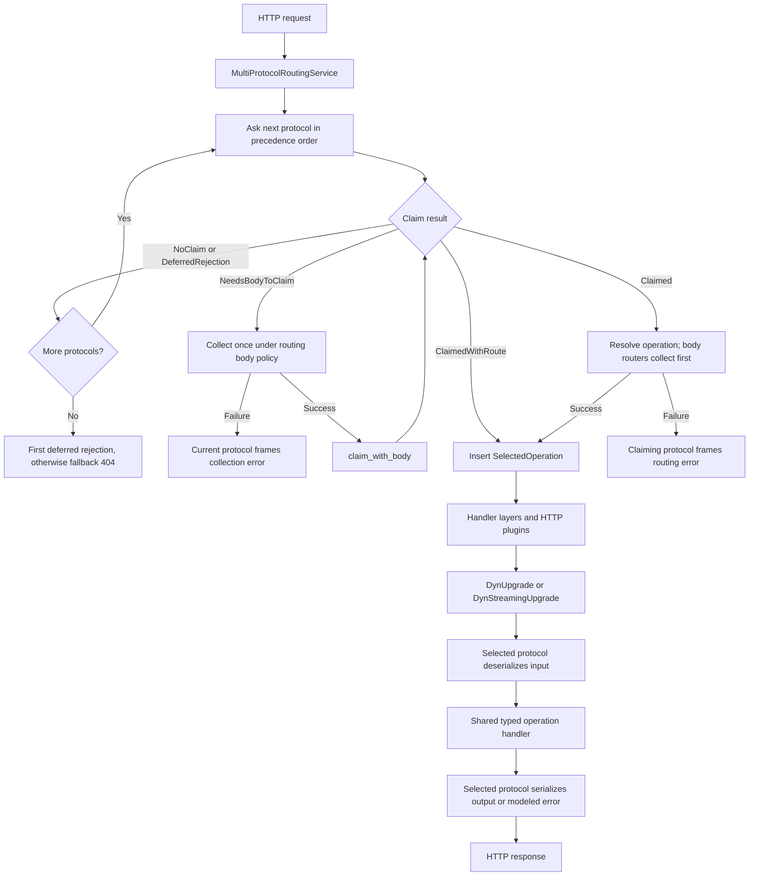

# RFC: Server protocol claims and multiprotocol dispatch

> Status: RFC
>
> Applies to: server (`codegen.schemaSerde = true`, HTTP 1.x)

## Purpose

A service migrating to Rust may have existing Coral callers and newer Smithy
callers. It must serve both without requiring every caller to migrate together.

Serve every protocol declared on a Smithy service through one
`MultiProtocolRoutingService`, which implements Tower's `Service`. Each operation
has one typed handler shared by all protocols. Runtime protocol implementations
identify requests, select operations, deserialize inputs, and serialize responses
and errors. Protocol-specific routing and serde stay in runtime crates.

## Service construction

Generated SDKs emit canonical `ServiceSchema`/`OperationSchema` descriptors and
bind each operation to an HTTP handler route. The route wraps the typed handler
in `DynUpgrade` or `DynStreamingUpgrade`; it does not choose a protocol at
construction. The generated service wraps `MultiProtocolRoutingService`.

The generated builder passes four inputs to `MultiProtocolRoutingServiceBuilder`:

1. The service schema, including its declared protocol shape IDs.
2. Additional protocol registries contributed by codegen decorators.
3. One `(OperationSchema, handler route)` binding per operation.
4. `ProtocolOptions`, containing shared `ServiceConfig` and per-protocol settings.

At `.build()`, the runtime resolves declared protocols against
`ProtocolRegistry::BUILTIN` and the additional registries, validates precedence
and bindings, and creates each served protocol and its router. Router construction
receives `ClaimMode::SoleProtocol` when exactly one protocol is served, or
`ClaimMode::Strict` when several are served. Protocol factories
receive shared configuration and their own
`customizationConfig.protocols.<shape ID>` section. Registered protocols that the
service does not declare participate in precedence validation but are not served.

The resulting service holds the ordered protocol routers and one shared handler
table. A router returns an `OperationTarget` identifying an entry in that table.
The same operation therefore reaches the same handler whether the request is
JSON, XML, CBOR, or a protocol supplied by another runtime crate.

### Adding a protocol registry

A runtime crate exports a static registry. For example, an
`example-server-protocols` crate could provide a metadata-routed legacy protocol:

```rust
use aws_smithy_http_server::schema::{
    ProtocolOrder, ProtocolRegistration, ProtocolRegistry,
};

// LegacyRpcProtocol implements ServerProtocol and MetadataRoutedProtocol.
pub static PROTOCOLS: ProtocolRegistry = ProtocolRegistry::new(&[
    ProtocolRegistration::metadata_routed::<LegacyRpcProtocol>(
        "example.protocols#legacyRpc",
    )
    .with_order(&[ProtocolOrder::Before("smithy.protocols#rpcv2Cbor")]),
]);
```

Its factory constructs the protocol from `ProtocolBuildContext`; its router
selects from the supplied operation targets. A protocol that needs body bytes
instead implements `BodyRoutedProtocol` and registers with `body_routed`.
Both kinds implement `ServerProtocol` for serde and error framing.

A codegen decorator contributes a reference through
`ServerCodegenDecorator.protocolRegistries`. This example assumes the runtime
crate is a sibling of the generated SDK:

```kotlin
override fun protocolRegistries(
    codegenContext: ServerCodegenContext,
): List<Writable> {
    val registry = CargoDependency(
        name = "example-server-protocols",
        location = Local("../"),
    ).toType().resolve("PROTOCOLS")
    return listOf(writable {
        rustTemplate("&#{Registry}", "Registry" to registry)
    })
}
```

Using the dependency's `RuntimeType` also adds the runtime crate to the generated
`Cargo.toml`. Contributions from multiple decorators are combined. The service
model must declare `example.protocols#legacyRpc`, and codegen must recognize the
protocol trait; the registry hook supplies its runtime implementation.

For a hypothetical `ExampleService` with `GetItem` and `PutItem`, the generated
builder then emits wiring equivalent to this excerpt. The handler fields already
contain upgrade services and configured HTTP plugins:

```rust
use aws_smithy_http_server::{
    schema::routing::MultiProtocolRoutingServiceBuilder,
    service::SchemaServiceShape,
};

let schema = <ExampleService as SchemaServiceShape>::SCHEMA;
let handlers = [
    self.get_item.expect("GetItem handler was checked"),
    self.put_item.expect("PutItem handler was checked"),
];
let svc =
    MultiProtocolRoutingServiceBuilder::from_operation_handler_bindings_with_options(
        schema,
        [&example_server_protocols::PROTOCOLS],
        schema.operations().iter().copied().zip(handlers),
        self.routing_options,
    )
    .layer(self.layer)
    .build()
    .map_err(BuildError::Routing)?;

Ok(ExampleService { svc })
```

Codegen emits schemas and handlers in the same operation order. With several
registry contributions, the second argument contains all their references;
with none, it is an empty iterator. The runtime always consults the built-in
registry, so generated code supplies only additional registries.

`ProtocolOptions` carries generated configuration defaults into construction.
The generated `request_body_config` setter can replace body policy; general
Rust overrides for protocol settings are described in the
[schema RFC](rfc0047_server_schema_serde.md).

### Protocol precedence

Precedence determines which protocol owns a request that more than one protocol
can claim. Registrations declare `ProtocolOrder::Before` and
`ProtocolOrder::After` constraints. The builder combines them into a directed
acyclic graph (DAG), where an edge `A → B` means “probe A before B.”

- A declaring `Before(B)` and B declaring `After(A)` express the same edge.
- Ordering is transitive: `A → B → C` places A before C even when the service
  serves only A and C.
- Every pair of served protocols must be connected by an ordering path in one
  direction. Otherwise the builder cannot choose which to probe first.
- Model declaration order, registry insertion order, and entry order within a
  registry do not determine precedence.

The graph includes all registrations, including protocols the service does not
serve. The builder validates that graph, then derives a unique claim order for
the served protocols. Cycles, references to unregistered protocols, and unordered
pairs of served protocols fail construction.

Built-in precedence:

```text
rpcv2Cbor → awsJson1_0 → awsJson1_1 → restJson1 → restXml
```

The earlier registry example puts `legacyRpc` before this chain. Alternatively,
to place it between AWS JSON 1.1 and REST JSON, register it with both boundaries:

```rust
ProtocolRegistration::metadata_routed::<LegacyRpcProtocol>(
    "example.protocols#legacyRpc",
)
.with_order(&[
    ProtocolOrder::After("aws.protocols#awsJson1_1"),
    ProtocolOrder::Before("aws.protocols#restJson1"),
])
```

The resulting order is:

```text
rpcv2Cbor → awsJson1_0 → awsJson1_1 → legacyRpc → restJson1 → restXml
```

`After(awsJson1_1)` alone would leave `legacyRpc` unordered relative to
`restJson1` and `restXml`. Both boundaries make the intended placement explicit.
These constraints choose probe order; a protocol must still claim the request
before it owns dispatch.

Missing or duplicate registrations, unresolved precedence references, cycles,
incomparable served protocols, invalid protocol settings, and invalid operation
bindings fail construction. Registries extend the available implementations;
they do not replace built-ins or enable undeclared protocols.

## Request flow



Deferred rejections are retained while probing continues. Once ownership is
committed, routing and collection errors are terminal. Collected body bytes and
trailers are replayed to the selected handler. Streaming-input recognition can
skip `NeedsBodyToClaim`, as described below.

## Claim contract

Each request is passed to the **served** protocols in precedence order until one
claims ownership. Claiming answers “is this my request?” Routing then answers
“which operation does it invoke?”

There are two router interfaces:

- `MetadataProtocolRouter` examines the method, URI, query, and headers without
  reading the body. Its `claim` returns `RouteClaim`.
- `BodyProtocolRouter` first examines the same request metadata. Its `claim`
  returns `BodyRouteClaim`, which can additionally request body collection before
  deciding ownership. `claim_with_body` returns `RouteClaim`.

Each claim can be:

| Claim                            | Dispatch semantics                                                    |
| -------------------------------- | --------------------------------------------------------------------- |
| `ClaimedWithRoute(target)`       | Commit ownership; dispatch directly.                                  |
| `Claimed`                        | Commit ownership; resolve the operation. A body router first collects the body. Routing errors are terminal. |
| `DeferredRejection(error)`       | Retain the first rejection; continue probing.                         |
| `NoClaim`                        | Continue probing.                                                     |
| `NeedsBodyToClaim` (body router) | Collect, then invoke `claim_with_body`.                               |

The first claimant owns input deserialization, output/error serialization, and
routing-error framing. A later claimant supersedes a deferred rejection. With
no claimant, emit the first deferred rejection through its originating protocol;
otherwise return `404`, body `<UnknownOperationException/>\n`, no `Content-Type`.
The dispatch contract applies in both claim modes; routers use the mode to decide
how to identify requests.

`DeferredRejection` means the request signals a protocol but does not satisfy its
claim requirements. For example, AWS JSON can retain an unknown-target rejection
while a later REST protocol matches the request's route and MIME bindings.
Once a protocol returns
`Claimed`, subsequent routing, input validation, or deserialization failures
cannot cause dispatch to try another protocol.

## Claim modes and compatibility

`ClaimMode` distinguishes operation routing within a known protocol from
arbitration between protocols. The builder selects the mode from the number of
resolved, served protocols, not the number of registry entries. It passes the
mode through `RouterBuildContext`; it is not a user-selectable compatibility flag.

| Mode | Built-in metadata router behavior |
| --- | --- |
| `SoleProtocol` | Use native operation routing. A successful match returns `ClaimedWithRoute`; a routing failure returns `DeferredRejection`, which the sole protocol frames. |
| `Strict` | Require protocol identification before claiming. A request may be declined or deferred so another protocol can own it. |

In `SoleProtocol`, REST and AWS JSON leave `Content-Type` validation to request
deserialization. This preserves body-sensitive acceptance rules: for example, a
REST GET with no body can reach its handler without `Content-Type`, while a
nonempty document with an incompatible media type can still fail deserialization.
RPCv2 CBOR uses native routing and header validation, retaining missing or
unsupported protocol-header errors instead of declining ownership.

Adding a second served protocol switches all its routers to `Strict`. Requests
previously accepted without identification metadata may then reach another
protocol or remain unclaimed. This behavior change is part of enabling protocol
arbitration and must be tested explicitly.

The routing service still invokes `claim` in either mode. Custom metadata and
body routers receive the mode but remain responsible for their claim behavior;
`SoleProtocol` does not force them to accept every request. Body collection and
streaming exclusions remain the same in both modes.

## Strict identification

- **rpcv2Cbor:** `POST`, `Smithy-Protocol: rpc-v2-cbor`, known service/operation URI.
- **AWS JSON:** `POST /`, known `X-Amz-Target`, version-specific MIME; event-stream
  MIME is admitted only for event-stream inputs.
- **REST:** modeled method/URI/query bindings and present input MIME, including
  payload media types, configured aliases, and modeled `Content-Type` overrides.

Overlapping REST payload MIME and AWS JSON event-stream version ambiguity resolve
by protocol precedence.

## Body and handler dispatch

Collect routing bodies once under `ServiceRequestBodyConfig::for_routing`;
reuse immutable `Bytes` across probes and replay bytes/trailers to the handler.
This policy applies before an operation is selected; upgrade subsequently applies
the selected operation's collection policy when collecting its input.
Collection failures terminate dispatch and are framed by the protocol whose
body-dependent claim or routing step triggered collection.

Body routers receive only operations without streaming input or output. Before
honoring `NeedsBodyToClaim`, the service asks metadata routers whether they
recognize a streaming input. Recognition skips that body-dependent probe without
claiming the request; normal precedence still determines ownership. A claim
already made from metadata retains priority. Output-only streaming does not
trigger this safeguard.

Dispatch inserts `SelectedOperation` with the canonical operation schema,
selected protocol, and operation collection policy. Upgrade consumes that
selection to invoke the shared typed handler through the selected protocol.
Upgrade and streaming conversion are defined in
[Schema-driven server serde](rfc0047_server_schema_serde.md).

Generated schema services use this routing and upgrade path even when they
declare only one protocol. Services without `schemaSerde` retain legacy routing
and upgrade.

## Validation

Compare generated single-protocol services with `schemaSerde` enabled and
disabled to test backward compatibility through actual handlers. Cover missing
and incompatible `Content-Type`, empty documents, raw and typed payloads,
modeled content-type headers, and live streams. Compare routing rejection status,
headers, and body bytes against native behavior. RPCv2 CBOR retains the schema
protocol's existing Coral-compatible rejection framing, which differs from the
legacy Rust router's generic empty 404 for some header failures.

Generated integration tests should send requests in each declared protocol to
the same typed handler and assert protocol-specific response and error bytes.
Test the transition from one served protocol to several, including requests
whose ownership changes under strict identification.
Registry tests should cover external protocols, combined decorator contributions,
and construction failures. Dispatch tests should cover overlapping claims,
deferred rejections, body replay with trailers, collection failures, and streaming
inputs that must remain live.

## Changes checklist

- [ ] Registry resolution and precedence validation.
- [ ] Claim dispatch, deferred rejection, body replay, and streaming exclusion.
- [ ] Sole-protocol compatibility and strict multiprotocol identification tests.
- [ ] Generated multiprotocol integration tests and protocol-specific wire assertions.
